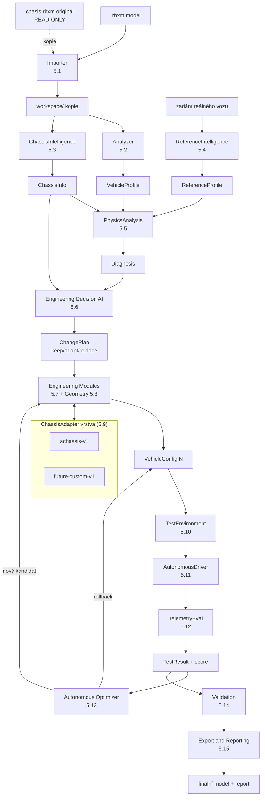

# AutoEngineerAI – Technická architektura

**Vlastněný soubor:** `C:/.DATA/AutoEngineerAI/docs/ARCHITECTURE.md`
**Stav:** Návrh v1.0 (FÁZE 0, ke schválení koordinátorem)
**Vazba:** Vychází z `C:/.DATA/AutoEngineerAI/docs/PROJECT-PLAN.md`, kapitol 4 (pracovní postup), 5 (moduly), 8 (struktura projektu).
**Jazyk dokumentu:** česky. Identifikátory, názvy typů a kód anglicky.
**Pravidla práce:** viz `C:/.DATA/AutoEngineerAI/docs/AGENT-RULES.md`.

---

## 1. Architektonické principy

1. **Samostatný systém.** AutoEngineerAI nemá runtime závislost na `C:/.DATA/RobloxSimulator` ani na `C:/Users/adamr/Downloads/chasis.rbxm`. Oba zdroje jsou pouze READ-ONLY vstup pro analýzu; přebírají se jen ověřené principy.
2. **Pipeline s neměnnými artefakty.** Každá fáze (kap. 4 plánu) produkuje verzovaný artefakt. Fáze nikdy nepřepisují vstup, pracují na kopiích.
3. **Chassis-agnostický návrh.** Veškerá logika nad konkrétním chassis jde přes rozhraní `ChassisAdapter`. A-Chassis je jeden z adaptérů, ne jádro systému.
4. **Měřitelnost.** Každá změna má `rationale`, každá důležitá změna má `TestResult`. Neověřená simulace se nikdy nevydává za Roblox runtime důkaz (princip 10 plánu).
5. **Determinismus a reprodukovatelnost.** Stejný `VehicleConfig` + stejná verze kódu + stejný testovací scénář = stejný výsledek v toleranci. Telemetry nese seed a verzi.
6. **Bezpečné změny.** Záloha před zásahem, verzování každé varianty, rollback na nejlepší známou konfiguraci.
7. **Oddělení vrstev:** analýza (čtení) → rozhodnutí (plán) → implementace (zápis do kopie) → test (měření) → optimalizace (cyklus) → validace → export. Žádný modul nepřeskakuje vrstvu.

## 2. Přehled modulů

Mapování na kapitolu 5 plánu. Moduly jsou logické balíčky, ne nutně procesy; komunikují přes soubory/artefakty (file-based contracts), aby šly spouštět odděleně i v dávkách.

| Modul | Odpovídá plánu | Vstup → Výstup |
|---|---|---|
| `Importer` | 5.1 | `.rbxm` model → `workspace/` kopie + `import_manifest.json` |
| `Analyzer` | 5.2 | kopie modelu → `VehicleProfile` |
| `ChassisIntelligence` | 5.3 | kopie modelu + skripty → `ChassisInfo` (typ, parametry, limity) |
| `ReferenceIntelligence` | 5.4 | zadání reálného vozu → `ReferenceProfile` (+ provenance ke každému údaji) |
| `PhysicsAnalysis` | 5.5 | `VehicleProfile` + `ReferenceProfile` → `Diagnosis` |
| `DecisionAI` | 5.6 | `Diagnosis` + `ChassisInfo` → `ChangePlan` |
| `Engineering/*` | 5.7–5.8 | `ChangePlan` + `VehicleConfig` → nová `VehicleConfig` + patch modelu |
| `PhysicsEngineIntelligence` | 5.9 | `Diagnosis` + `ChassisInfo` → rozhodnutí keep/adapt/replace |
| `TestEnvironment` + `AutonomousDriver` | 5.10–5.11 | `VehicleConfig` + scénář → surová telemetrie |
| `TelemetryEval` | 5.12 | surová telemetrie → `TestResult` + odchylky vs. cíl |
| `Optimizer` | 5.13 | `TestResult` historie → kandidátní `VehicleConfig` |
| `Validation` | 5.14 | finalista → validační verdikt (math / integration / roblox-runtime) |
| `ExportReport` | 5.15 | finalista + historie → exportní balíček |

`GeometryEngineering` (5.8) je součástí `Engineering/`, ale s přísnějším režimem: geometrické změny vyžadují zálohu + validační test funkčnosti před zařazením do optimalizační smyčky.

## 3. Datový model

Vše serializovatelné do JSON (LUau i Python čitelné). Jednotky SI + stupně; převody na Roblox jednotky řeší až adaptér/runtime vrstva, nikdy úložiště.

### 3.1 VehicleProfile (výstup Analyzeru, 5.2)

Popisuje **naměřený stav vstupního vozidla**, ne přání. Neměnný po vytvoření (immutable, verzovaný).

```jsonc
{
  "profile_id": "vp_2026_001",
  "source_model_hash": "sha256:…",
  "chassis": { "chassis_id": "… (viz ChassisInfo)" },
  "hierarchy": { "root": "…", "wheels": ["FL","FR","RL","RR"], "constraints": [...] },
  "dimensions": { "wheelbase_m": 2.7, "track_f_m": 1.55, "track_r_m": 1.55 },
  "mass": { "total_kg": 1400, "center_of_mass": [0, 0.55, 0.1], "inertia": [..] },
  "wheels": [ { "id": "FL", "radius_m": 0.33, "width_m": 0.225, "position": [..], "camber_deg": 0, "toe_deg": 0 } ],
  "suspension": { "…": "per-wheel spring/damper/travel" },
  "steering": { "max_angle_deg": 35, "ackermann_ratio": 1.0 },
  "powertrain": { "drive_type": "RWD|FWD|AWD", "gears": [3.2, 2.1, 1.5], "final_drive": 3.7 },
  "brakes": { "bias_front": 0.6 },
  "scripts": [ { "path": "…", "hash": "sha256:…" } ]
}
```

### 3.2 ReferenceProfile (výstup ReferenceIntelligence, 5.4)

Cílový profil reálného vozu. **Každá hodnota má provenance** (požadavek plánu 5.4).

```jsonc
{
  "vehicle": { "make": "…", "model": "…", "year": 2020 },
  "specs": {
    "power_kw": { "value": 150, "source": "url/citace", "confidence": 0.9, "uncertainty": "+-2%" },
    "torque_nm": { "value": 320, "source": "…", "confidence": 0.8 },
    "mass_kg": { "value": 1400, "source": "…", "confidence": 0.9 },
    "accel_0_100_s": { "value": 7.5, "source": "…", "confidence": 0.7 },
    "vmax_kmh": { "value": 230, "source": "…", "confidence": 0.8 }
  },
  "target_metrics": [ { "metric": "accel_0_100_s", "target": 7.5, "tolerance": 0.3, "weight": 1.0 } ]
}
```

Chybějící údaj = explicitní `null` + `confidence: 0`, nikdy odhad vydávaný za fakt.

### 3.3 VehicleConfig (to, co se optimalizuje)

Oddělená od profilu: profil = co bylo naměřeno, config = co se nastavuje. Každá varianta má ID a rodiče.

```jsonc
{
  "config_id": "cfg_0042",
  "parent_config_id": "cfg_0041",
  "vehicle_profile_id": "vp_2026_001",
  "chassis_adapter": "achassis-v1",
  "parameters": {
    "engine": { "peak_torque_nm": 320, "peak_power_kw": 150 },
    "transmission": { "gears": [3.2, 2.1], "final_drive": 3.7, "shift_rpm": 6000 },
    "tires": { "grip_long": 1.0, "grip_lat": 1.0 },
    "suspension": { "spring_f_Npm": 30000, "damper_f_Nspm": 3000 },
    "steering": { "max_angle_deg": 35 },
    "brakes": { "bias_front": 0.6, "torque_Nm": 4000 },
    "geometry_overrides": null
  },
  "rationale": "proč tato změna (odkaz na ChangePlan krok)",
  "model_patch_ref": "patches/cfg_0042.patch"
}
```

### 3.4 ChangePlan (výstup DecisionAI, 5.6)

```jsonc
{
  "plan_id": "plan_0012",
  "diagnosis_ref": "dg_0007",
  "steps": [ { "area": "transmission", "action": "set_final_drive", "from": 3.7, "to": 3.4, "expected_effect": "vmax +5 km/h", "risk": "horší akcelerace" } ],
  "chassis_decision": "keep | adapt | replace",
  "priorities": ["tires", "transmission"],
  "stop_conditions": { "max_iterations": 50, "target_score": 0.95 }
}
```

### 3.5 TestResult (výstup TelemetryEval, 5.12)

```jsonc
{
  "result_id": "tr_0100",
  "config_id": "cfg_0042",
  "scenario_id": "straight_brake_100_0",
  "environment": { "mode": "local-sim | roblox-runtime", "seed": 1234, "code_version": "git-sha" },
  "metrics": { "accel_0_100_s": 7.8, "vmax_kmh": 228, "brake_100_0_m": 41.2, "stability_index": 0.93 },
  "deviations_vs_target": { "accel_0_100_s": +0.3 },
  "score": 0.91,
  "reproduced_runs": 3,
  "raw_telemetry_ref": "telemetry/tr_0100.csv"
}
```

`score` = vážená shoda s `target_metrics` z ReferenceProfile; váhy řeší multikriteriální požadavek 5.13 (žádné zlepšení akcelerace za cenu nepřijatelné stability).

## 4. Komunikace mezi moduly a workflow

Záměrně **souborová (file-based)**, ne RPC: každý modul je spustitelný skript/funkce `run(input_paths) -> output_paths`. Důvody: auditovatelnost, možnost ručního kroku, oddělení lokální simulace od Roblox runtime.

Hlavní pipeline (číslování = kap. 4 plánu, kroky 1–16):

```text
.rbxm → [Importer] → workspace/ → [Analyzer + ChassisIntelligence] → VehicleProfile + ChassisInfo
                                                            ↓
zadání vozu → [ReferenceIntelligence] → ReferenceProfile ──→ [PhysicsAnalysis] → Diagnosis
                                                            ↓
                                              [DecisionAI] → ChangePlan (vč. keep/adapt/replace)
                                                            ↓
                                              [Engineering/*] → VehicleConfig_N (patch na kopii)
                                                            ↓
                                              [TestEnv + Driver] → telemetrie → [TelemetryEval] → TestResult
                                                            ↓
                                              [Optimizer] ⇄ cyklus (nové Config → test → TestResult)
                                                            ↓
                                              [Validation] → verdikt → [ExportReport] → balíček
```

Kontrakt cyklu optimalizátoru (5.13): optimizer čte **celou historii** `TestResult`, nikdy jen poslední výsledek; vždy drží `best_config_id`; zastaví při `target_score` nebo `max_iterations`; neúspěšná větev = rollback, ne patch přes patch.

## 5. Rozhraní (contracts)

### 5.1 Analyzer → PhysicsAnalysis

```python
def analyze(model_copy_dir: str) -> VehicleProfile: ...
def diagnose(profile: VehicleProfile, reference: ReferenceProfile, chassis: ChassisInfo) -> Diagnosis: ...
```

`Diagnosis` = seznam `{area, symptom, probable_cause, evidence_metrics}`. Požadavek 5.5: příčina, ne jen projev.

### 5.2 PhysicsAnalysis → Optimizer (přes DecisionAI)

Optimizer nikdy nemění geometrii/konstrukci bez `ChangePlan` kroku s `risk` a bez zálohy. Parametrický prostor optimalizace je explicitní:

```python
def search_space(config: VehicleConfig, plan: ChangePlan) -> list[ParameterRange]: ...
def propose(history: list[TestResult], space: list[ParameterRange]) -> list[VehicleConfig]: ...
```

### 5.3 Testy: TestEnvironment ↔ AutonomousDriver ↔ TelemetryEval

```python
def run_scenario(config: VehicleConfig, scenario: Scenario, mode: str) -> RawTelemetry: ...
def evaluate(telemetry: RawTelemetry, reference: ReferenceProfile) -> TestResult: ...
```

Scénáře (5.10–5.11): `straight_accel`, `straight_brake_100_0`, `slalom`, `constant_radius_turn`, `bump_section`, `surface_change`. Každý scénář má pevný seed a toleranci reprodukovatelnosti. `mode` se povinně zapisuje do `TestResult.environment` — lokální simulace ≠ Roblox runtime důkaz.

### 5.4 ChassisAdapter (nezávislost na A-Chassis, 5.9)

```python
class ChassisAdapter:
    id: str                      # "achassis-v1", "custom-future-v1"
    def detect(self, model_copy_dir) -> float: ...        # 0..1 jistota
    def list_parameters(self) -> list[ParameterDef]: ...  # co lze měnit
    def apply_config(self, model_copy_dir, config: VehicleConfig) -> PatchReport: ...
    def limits(self) -> list[str]: ...                    # známá omezení
```

Nový chassis = nová třída implementující toto rozhraní + záznam v registru `src/Chassis/adapters/`. Jádro (optimizer, testy, export) na konkrétní chassis nikdy nesahá přímo. Rozhodnutí keep/adapt/replace (5.9) je datové pole `ChangePlan.chassis_decision`, ne větvení kódu v každém modulu.

Kritéria replace (z 5.9): přesnost, stabilita, výkon, rozšiřitelnost, kompatibilita s Roblox runtime, kvalita testování. Pokud adaptér hlásí limit blokující cíl (např. nelze nastavit AWD), DecisionAI navrhne `adapt` nebo `replace` s odhadem nákladů.

## 6. Ukládání, verzování, zálohování, rollback

```
vehicle-data/
  references/<make>_<model>_<year>.json   # ReferenceProfile (immutable, hash)
  analyzed/<profile_id>.json              # VehicleProfile (immutable)
  configurations/<config_id>.json         # VehicleConfig (immutable, parent link)
  results/<result_id>.json                # TestResult (immutable)
  telemetry/<result_id>.csv               # surová data
  runs/<run_id>/manifest.json             # co se kdy spustilo, s code_version
exports/<run_id>/                          # finální balíček (model + config + report)
assets/chassis-original/                   # nedotknutelné originály (kopie chasis.rbxm)
```

Pravidla:

1. Artefakty se **nemění**, jen přibývají. Oprava = nový soubor s novým ID.
2. Každý `VehicleConfig` odkazuje na `parent_config_id` → úplná linie pro rollback.
3. Před geometrickým/konstrukčním zásahem povinná záloha kopie modelu (`workspace/snapshots/`).
4. Rollback = nastavení `best_config_id` jako aktivního + reaplikace adaptérem; neúspěšné větve se nemažou (slouží jako negativní evidence pro optimizer).
5. `manifest.json` každého běhu obsahuje `code_version` (git SHA), seed, verze scénářů — jinak je výsledek neplatný pro srovnání.
6. Git verzuje kód + `vehicle-data/**/*.json` (malé). Velké `.rbxm`/telemetrie mimo git (LFS nebo externí úložiště — rozhodnout při implementaci, viz Neznámé).

## 7. Struktura repozitáře (konkretizace kap. 8 plánu)

```
AutoEngineerAI/
  docs/               # ARCHITECTURE.md (tento soubor), PROJECT-PLAN.md, …
  src/
    Importer/
    Analyzer/         # vč. ChassisIntelligence (detekce) jako podmodul
    Chassis/
      adapters/       # achassis_v1.py, registry.py, base.py (ChassisAdapter)
    Reference/
    Physics/
    Engineering/      # Engine, Transmission, Drivetrain, Tires, Suspension, Steering, Brakes, Geometry, Construction
    DecisionAI/
    Optimizer/
    Testing/          # TestEnvironment, AutonomousDriver, Telemetry
    Validation/
    Export/
  vehicle-data/       # viz kap. 6 (references, analyzed, configurations, results, telemetry, runs)
  assets/chassis-original/
  tests/              # unit, integration, physics, runtime, regression
  tools/              # pomocné skripty (konverze jednotek, hash, validace schémat)
```

Zásada plánu: adresáře vznikat postupně podle potřeby, žádné prázdné placeholdery. Pořadí zakládání viz kap. 9.

## 8. Mermaid diagram modulů a datových toků



## 9. Technická rizika

1. **A-Chassis blackbox.** Skutečný obsah `chasis.rbxm` dosud neauditován (FÁZE 1 neproběhla). Riziko: parametry nepůjdou měnit programově → mitigace: adaptér s `limits()`, fallback `replace`.
2. **Sim-to-real gap.** Lokální simulace ≠ Roblox fyzika. Mitigace: povinný `mode` flag, finální verdikt jen z `roblox-runtime` běhů (5.14).
3. **Nedostupná referenční data.** Chybějící momentové křivky, převody, rozložení hmotnosti → mitigace: provenance + confidence, explicitní `null`, váhy metrik.
4. **Stabilita optimalizace.** Multikriteriální prostor, riziko přetrénování na jeden scénář → mitigace: vážené skóre, regresní sada, držení `best_config_id`.
5. **Destruktivní geometrické změny.** Mitigace: snapshot + validační brána před zařazením do cyklu.
6. **Reprodukovatelnost.** Bez seedů a `code_version` jsou výsledky nesrovnatelné → mitigace: manifest povinný.
7. **Rozsah adaptéru.** Každý nový chassis = nový adaptér; náklady rostou lineárně. Mitigace: minimální interface (4 metody), registr, sdílené testy adaptéru.

## 10. Doporučené pořadí implementace

Odvozeno z fází plánu; žádný krok nepřeskakovat:

1. **Kontrakty dat** (tato architektura → JSON schémata + validátory v `tools/`). Bez nich se moduly rozjedou.
2. **Importer + Analyzer** (FÁZE 4) → první `VehicleProfile` z reálného modelu.
3. **ChassisAdapter `achassis-v1`** (FÁZE 1 + 3) → `list_parameters` / `apply_config` na kopii.
4. **ReferenceIntelligence** (FÁZE 5) → 2–3 referenční vozy s provenance.
5. **TestEnvironment + Driver + TelemetryEval** (FÁZE 9) → reprodukovatelný `TestResult`, nejprve 1 scénář (`straight_accel`).
6. **DecisionAI v0 (pravidlový)** (FÁZE 7) → `ChangePlan` bez LLM, deterministický.
7. **Optimizer v0 (grid/hill-climb)** (FÁZE 10) → cyklus na 2–3 parametrech.
8. **Validation + Export** (FÁZE 12–13) → runtime brána + balíček.
9. **Geometry/Construction + Physics replace** (FÁZE 11) → až po stabilním parametrickém cyklu.
10. **Knowledge transfer z RobloxSimulatoru** (FÁZE 2) průběžně jako zdroj vzorců pro Physics/Telemetry, ne jako kódová závislost.

## 11. Shrnutí, fakta, předpoklady, neznámé, zdroje, další kroky

**Shrnutí:** Navržena modulární, chassis-agnostická architektura se souborovými kontrakty. Jádrem je pětka artefaktů `VehicleProfile / ReferenceProfile / ChangePlan / VehicleConfig / TestResult`, vrstva `ChassisAdapter` izoluje A-Chassis, optimalizační cyklus drží nejlepší variantu a rozlišuje lokální simulaci od Roblox runtime důkazu.

**Ověřená fakta:**
- Projektový root `C:/.DATA/AutoEngineerAI` existuje; obsahuje `docs/` (`AGENT-RULES.md`, `PROJECT-PLAN.md`, `STATUS.md`), `assets/chassis-original/` (prázdný), `vehicle-data/references/` (prázdný). Ověřeno výpisem adresáře před zápisem.
- Požadavky kapitol 4, 5, 8 plánu jsou opsány výše včetně číslování modulů 5.1–5.15 a struktury repozitáře.
- READ-ONLY zdroje (`C:/.DATA/RobloxSimulator`, `C:/Users/adamr/Downloads/chasis.rbxm`) nebyly v rámci této úlohy čteny ani zapisovány — architektura je záměrně nezávislá na jejich obsahu.

**Předpoklady:**
- JSON jako výměnný formát vyhoví i Luau straně (přes HttpService) i Python nástrojům.
- A-Chassis půjde parametrizovat programově na kopii modelu (jinak nastane větev `replace`, se kterou návrh počítá).
- Testovací scénáře půjdou reprodukovat v toleranci pomocí seedů.

**Neznámé (nutno dořešit ve FÁZÍCH 1–2):**
- Skutečná hierarchie a parametry `chasis.rbxm` (audit neproběhl).
- Které vzorce z RobloxSimulatoru jsou přenositelné (knowledge transfer neproběhl).
- Kam s velkými binárními artefakty (git LFS vs. externí úložiště).
- Konkrétní metriky vah pro `score` a tolerance reprodukovatelnosti.

**Zdroje:**
- `C:/.DATA/AutoEngineerAI/docs/PROJECT-PLAN.md`, kapitoly 4, 5, 8 (celé přečteny).
- `C:/.DATA/AutoEngineerAI/docs/AGENT-RULES.md` (celý přečten; dodrženo: čeština, vlastněný soubor, absolutní cesty, žádné zápisy mimo rozsah).

**Další kroky:**
1. Koordinátor schválí/zamítne tuto architekturu.
2. Založit JSON schémata + validátory (`tools/`) dle kap. 3.
3. Spustit FÁZI 1 (audit A-Chassis) a FÁZI 2 (knowledge transfer) jako vstupy pro adaptér.

## 12. Hybridní režim M1–M9 (doplněno 2026-11-19, nemění kapitoly 1–11)

Nad touto architekturou stojí hybridní plán: `docs/IMPLEMENTATION_ROADMAP.md` (backlog M1–M9),
`docs/HYBRID_WORKFLOW.md` (proces člověk + stroj), `docs/PRODUCT_VISION.md` (vize),
`docs/VEHICLE-SPECIFICATIONS.md` (Mustang GT 2024 EU), `docs/ACCEPTANCE_CRITERIA.md` (brány),
`docs/PROJECT_STATUS.md` (audit stavu), `AGENTS.md` (instrukce). Mapování:
M1→ReferenceIntelligence, M2→Analyzer, M3/M4→PhysicsAnalysis, M5→DecisionAI/ChassisAdapter,
M6→Engineering/VariantStore, M7→TestEnvironment, M8→TelemetryEval/Optimizer, M9→orchestrace.
Pětice artefaktů (`VehicleProfile / ReferenceProfile / ChangePlan / VehicleConfig / TestResult`)
zůstává; M-kroky ji používají přes `contracts/*.schema.json`. Kategorie parametrů
(`MUTABLE_TUNE | SCRIPT_CONTROLLED | STRUCTURE_CONTROLLED | READ_ONLY | UNKNOWN`) a `mode`
flag simulace-vs-runtime se nemění.
